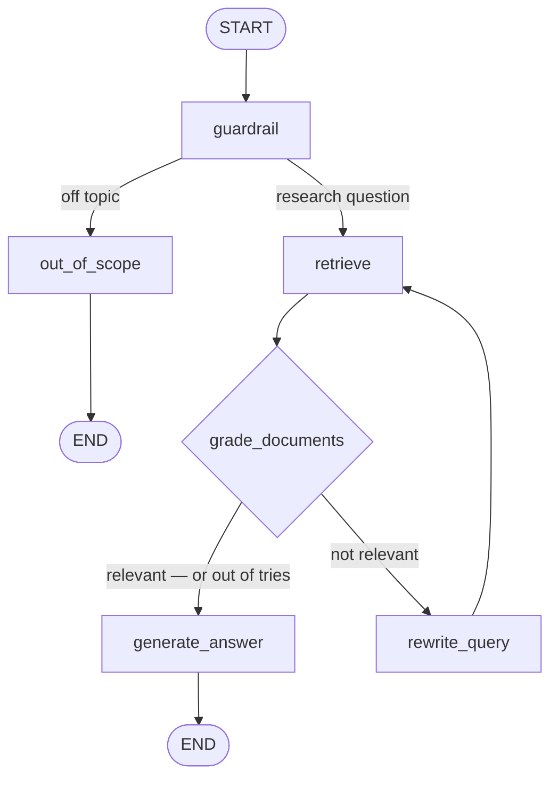

# Agentic RAG node graph

`/api/v1/ask-agentic` runs a six-node workflow (a LangGraph graph): a scope
guardrail, then retrieval with a grade-and-retry loop (2 tries), then answer
generation. Built in
[`src/services/agents/workflow.py`](../src/services/agents/workflow.py); nodes in
[`src/services/agents/nodes/`](../src/services/agents/nodes/).

- **guardrail** — Is this a CS / AI / ML research question? If not, stop here.
- **out_of_scope** — Short "that's outside what I cover" reply.
- **retrieve** — Hybrid search for the most relevant paper chunks.
- **grade_documents** — Do the retrieved chunks actually answer the question?
- **rewrite_query** — Rephrase the question and search again.
- **generate_answer** — Write a grounded answer from the chunks that passed.

If the second retrieval still grades as irrelevant, the graph goes to
`generate_answer` anyway, and it replies that it couldn't find relevant papers.
