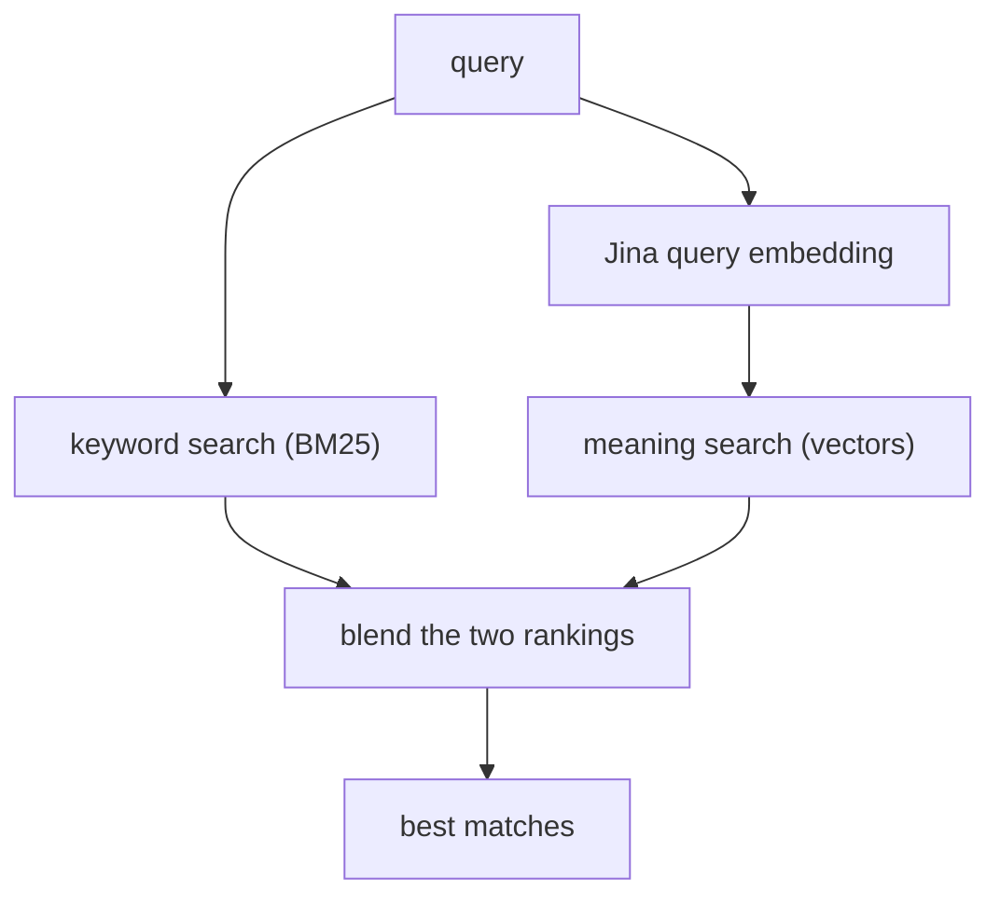

# Hybrid search

`HybridSearchService` searches the indexed paper chunks two ways at once — by
keyword and by meaning — then blends the two ranked lists into one. This is what
the agent's `retrieve` node and `/api/v1/papers/search/hybrid` use. Defined in
[`src/services/hybrid_search.py`](../src/services/hybrid_search.py).

- **Keyword search (BM25)** — Exact-term matching; strong on names, acronyms, and notation.
- **Meaning search (vectors)** — Compares the query's Jina embedding against the chunk embeddings; strong on paraphrase.
- **Blending (RRF)** — Score each chunk by how high it sits in each list, add those scores, keep the top few. Because it only looks at rank position, the two searches' score scales don't need to match. (Per list: `1 / (60 + rank)`.)

Each search fetches about twice as many candidates as requested before blending.
An optional arXiv-category filter is applied to both searches.
